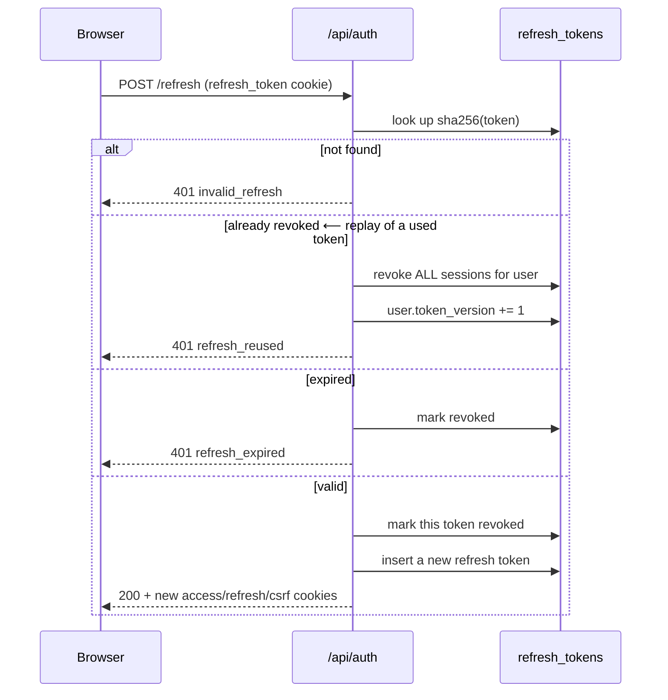
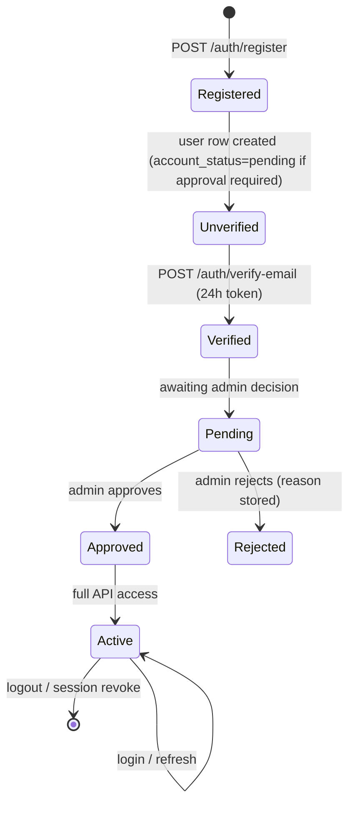

# Authentication and Authorisation

Sessions are **cookie-based**, not bearer tokens in browser storage. That decision drives almost
everything else here: CSRF protection, same-origin deployment, and the media-token workaround for
`` sources.

- Routes: `backend/app/api/auth.py`
- Logic: `backend/app/services/auth_service.py`
- Primitives: `backend/app/core/security.py`
- Enforcement: `backend/app/api/deps.py`
- Client: `frontend/src/components/auth/auth-provider.tsx`, `frontend/src/lib/api.ts`

---

## 1. Cookies

Three cookies are set on login, refresh, email verification, and password reset.

| Cookie | Contents | Lifetime | HttpOnly |
| --- | --- | --- | --- |
| `access_token` | JWT (HS256) | 15 min (`ACCESS_TOKEN_EXPIRE_MINUTES`) | yes |
| `refresh_token` | Opaque random token | 7 days (`REFRESH_TOKEN_EXPIRE_DAYS`) | yes |
| `csrf_token` | Opaque random token | 7 days | **no** — the UI must read and echo it |

Common attributes: `path=/`, `SameSite=Lax`, `Secure` when `COOKIE_SECURE=true`, optional `Domain`
from `COOKIE_DOMAIN`.

`SameSite=Lax` is why deployment must be single-origin: a cross-site API host would neither send the
cookie nor satisfy the CSRF check.

---

## 2. Access tokens

```json
{
  "sub": "<user uuid>",
  "role": "user | admin",
  "tv": 3,
  "type": "access",
  "iat": 1700000000,
  "exp": 1700000900
}
```

`decode_access_token` rejects any token whose `type` is not `access`, so a refresh value cannot be
replayed as an access token.

On every request, `_user_from_token` re-validates against the database and rejects the token when any
of these disagree with the stored user:

| Check | Effect when false |
| --- | --- |
| user exists | 401 |
| `is_active` | 401 (admin suspension) |
| `email_verified_at` is set | 401 (unverified accounts cannot use the API) |
| `tv == user.token_version` | 401 (all sessions revoked) |
| `role == user.role` | 401 (role changed mid-session) |

Because `role` and `tv` are embedded, a demotion or a forced logout takes effect immediately without
a server-side token list.

---

## 3. Refresh tokens and replay detection

Refresh tokens are opaque (`secrets.token_urlsafe(48)`) and stored **only as a SHA-256 hash** in
`refresh_tokens`. Each row records `user_agent`, `ip_address`, `expires_at` and `revoked_at`.

Rotation is strict:



The replay branch is the important one: presenting a already-rotated token is treated as theft, so
the entire session family is invalidated and `token_version` is bumped, killing outstanding access
tokens too.

---

## 4. CSRF

Cookie-authenticated mutations use double-submit:

1. `csrf_token` cookie (readable by JS).
2. `X-CSRF-Token` header sent by `frontend/src/lib/api.ts`.
3. Server compares them with `hmac.compare_digest`.

`check_csrf` runs inside `get_current_user` **only when** the token came from a cookie and the method
is `POST`/`PUT`/`PATCH`/`DELETE`. A bearer-header token skips CSRF, since it cannot be attached by a
cross-site form.

`POST /api/auth/logout` has a deliberate exception: it accepts a missing access token (browser
sessions outlive the 15-minute JWT) but still requires CSRF when no `Authorization` header is
present. Without this, logout would fail — and the refresh cookie would silently sign the user back
in on the next page load.

---

## 5. Account lifecycle



Two independent gates:

| Gate | Column | Enforced by |
| --- | --- | --- |
| Email verified | `users.email_verified_at` | `_user_from_token` — token rejected outright |
| Account approved | `users.account_status` | `require_approved_user` — session valid, but only `/api/auth/*` reachable |

`is_active` is a third, separate flag meaning "admin suspended", deliberately distinct from
`account_status`.

`REGISTRATION_REQUIRES_APPROVAL` (default `true`) decides whether new signups start `pending` or are
auto-approved. Admin-created accounts and pre-existing rows default to `approved`.

Pending and rejected users can still hold a session, refresh it, and log out — which is exactly why
`/api/auth/*` sits outside the approval gate.

---

## 6. Authorisation model

Two roles, `user` and `admin`, plus ownership.

| Dependency | Allows |
| --- | --- |
| `get_current_user` | Any valid, verified session |
| `require_approved_user` | `account_status == approved` (allow-list: any future status is denied) |
| `require_admin` | Composes `require_approved_user`, then requires `role == admin` |

Composing the approval gate inside `require_admin` is intentional: a pending or rejected account
cannot reach the admin surface even if it carries the admin role.

Resource ownership:

| Helper | Rule |
| --- | --- |
| `can_view_full_book(book, user)` | admin **or** `book.owner_id == user.id` |
| `get_owned_book_or_404` | 404 when missing **or** not visible — never confirms another user's book exists |
| `get_job_for_user_or_404` | admin, requester, or owner of the job's book |

Every application router is mounted with `require_approved_user`; `admin` applies `require_admin`
internally.

---

## 7. Passwords

- **Hashing:** Argon2 via `argon2.PasswordHasher`; `password_needs_rehash` supports transparent
  upgrades on next login.
- **Policy:** minimum length from `PASSWORD_MIN_LENGTH` (default 10).
- **Reset:** token valid for `PASSWORD_RESET_EXPIRE_MINUTES` (60), stored hashed, single-use
  (`used_at`). A successful reset calls `revoke_all_sessions`, so every existing device is signed out.
- **Change:** `POST /auth/change-password` requires the current password and clears cookies
  afterwards.

Email tokens (`email_tokens`) are hashed, purpose-scoped (`verify_email`, `reset_password`), expiring,
and single-use. Verification is valid for `EMAIL_VERIFICATION_EXPIRE_HOURS` (24).

---

## 8. Media access without cookies

`` cannot send an `Authorization` header, and third-party contexts may not send cookies.
Images are therefore served with **signed, scoped, short-lived tokens**:

- `issue_media_token(scope, resource_id)` produces a token bound to one page or one book thumbnail.
- `verify_media_token(token, scope, resource_id)` checks signature, TTL, and that both `scope` and
  `resource_id` match.
- `thumbnail_url`, `page_image_url`, `page_preview_url` build the URLs.

Media routes accept **either** a valid session **or** a valid token, which is why they are mounted
without the approved-user dependency. Ownership is still enforced inside each handler.

---

## 9. Rate limiting on credential endpoints

The five credential endpoints share a stricter bucket than the general API:

| Scope | Limit |
| --- | --- |
| Global, per IP | 60 requests / 60 s |
| `login`, `register`, `forgot-password`, `reset-password`, `resend-verification` | 10 requests / 60 s |

Client IP comes from `CF-Connecting-IP`, else the **last** `X-Forwarded-For` hop. Earlier hops are
attacker-controlled. The residual risk — a direct caller to the origin forging either header — is
tracked in [launch readiness](../../plans/011-launch-readiness.md).

If Redis is unavailable, rate limiting is skipped rather than failing requests.

---

## 10. Frontend behaviour

`AuthProvider` loads the session (`GET /api/auth/me`), exposes `user`, `loading`, `isAdmin`,
`isApproved`, and wires `POST /api/auth/refresh` on 401. `RouteGuard` then applies navigation rules:

- unauthenticated → `/login?next=…`
- unapproved → `/pending-approval`
- non-admin on `/admin` → `/dashboard`

The guard is UX only — the backend independently enforces every rule.

---

## 11. Known gaps

1. **No MFA.**
2. **No password strength check beyond length.**
3. **No account lockout after repeated failures** — only the per-IP rate limit.
4. **Media tokens are bearer credentials**; anyone with the URL can fetch that one resource until TTL
   expiry. This is accepted for images and is scoped per resource.
5. **`ip_address` on refresh tokens records `request.client.host`**, which behind a proxy is the
   proxy. It is informational, not a security control.

