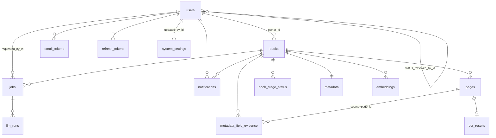

# Data Model

All persistent state lives in PostgreSQL 16 with the `pgvector` extension. SQLAlchemy 2.x models are
in `backend/app/models/`; migrations are in `backend/alembic/versions/`.

Base mixins (`backend/app/models/base.py`):

| Mixin | Provides |
| --- | --- |
| `UUIDMixin` | `id UUID PRIMARY KEY DEFAULT uuid4()` |
| `TimestampMixin` | `created_at` (server default `now()`), `updated_at` (`now()`, on update) |

Not every table uses both — `Page`, `Job`, `LlmRun` and `Notification` have no `updated_at`.

---

## 1. Entity relationships

---

## 2. Tables

### `users`

| Column | Type | Notes |
| --- | --- | --- |
| `id` | UUID | PK |
| `email` | varchar(320) | unique, indexed, normalised lowercase |
| `display_name` | varchar(120) | |
| `password_hash` | varchar(255) | Argon2 |
| `role` | varchar(20) | `user` \| `admin`, default `user` |
| `is_active` | boolean | default `true`; `false` means admin-suspended |
| `account_status` | varchar(20) | `pending` \| `approved` \| `rejected`, default `approved`, indexed |
| `status_reviewed_at` | timestamptz | |
| `status_reviewed_by_id` | UUID | FK `users.id` `ON DELETE SET NULL` |
| `rejection_reason` | varchar(500) | |
| `email_verified_at` | timestamptz | null ⇒ API rejects the session |
| `last_login_at` | timestamptz | |
| `token_version` | integer | default `0`; bump invalidates all access tokens |
| `email_notifications_enabled` | boolean | default `false` (email alerts are opt-in); in-app delivery is never gated by this |
| `created_at`, `updated_at` | timestamptz | |

### `refresh_tokens`

| Column | Type | Notes |
| --- | --- | --- |
| `user_id` | UUID | FK `users.id` `ON DELETE CASCADE`, indexed |
| `token_hash` | varchar(64) | unique; SHA-256 of the opaque token, never the token itself |
| `expires_at` | timestamptz | 7 days by default |
| `revoked_at` | timestamptz | set on rotation, logout, or replay detection |
| `user_agent` | varchar(500) | |
| `ip_address` | varchar(45) | proxy address behind Traefik; informational |

### `email_tokens`

| Column | Type | Notes |
| --- | --- | --- |
| `user_id` | UUID | FK `users.id` `ON DELETE CASCADE`, indexed |
| `purpose` | varchar(20) | `verify_email` \| `reset_password` \| `verify_new_email` |
| `token_hash` | varchar(64) | unique |
| `expires_at` | timestamptz | 24 h verify, 60 min reset |
| `used_at` | timestamptz | single-use enforcement |
| `pending_email` | varchar(320) | target address for `verify_new_email` (change-email flow) |

### `books`

| Column | Type | Notes |
| --- | --- | --- |
| `title` | varchar(500) | nullable; may be populated from extraction |
| `filename` | varchar(500) | not null |
| `language` | varchar(10) | default `tel`; user-correctable |
| `status` | varchar(30) | denormalised mirror of the stage machine (see below) |
| `total_pages` | integer | |
| `owner_id` | UUID | FK `users.id` `ON DELETE RESTRICT`, indexed |

`RESTRICT` is deliberate: a user with books cannot be deleted, preventing orphaned uploads.

### `pages`

| Column | Type | Notes |
| --- | --- | --- |
| `book_id` | UUID | FK `books.id` `ON DELETE CASCADE` |
| `page_number` | integer | 1-based, as printed in the PDF |
| `image_path` | varchar(500) | relative to `STORAGE_PATH` |
| `processed_image_path` | varchar(500) | set once preprocessing runs |
| `preprocessing_config` | JSONB | per-page pipeline parameters |
| `ocr_error` | text | last OCR failure for this page; cleared on success |

No timestamps: pages are rewritten in place on re-render.

### `ocr_results`

One row per page (`UNIQUE(page_id)`).

| Column | Type | Notes |
| --- | --- | --- |
| `raw_text` | text | engine output |
| `bounding_boxes` | JSONB | `{"words": [...]}` with boxes and confidences |
| `cleaned_text` | text | after normalisation/post-processing |
| `corrected_text` | text | human correction; **preferred** over cleaned and raw when building LLM input |
| `corrections` | JSONB | `{"rules": [...]}` applied automatically |
| `confidence` | float | average word confidence |
| `language_detected` | varchar(10) | |
| `ocr_engine` | varchar(20) | which engine produced the text |
| `ocr_route` | varchar(50) | set only when script routing changed engine/model |
| `ocr_coverage` | float | word count ÷ detected line count |
| `ocr_script` | JSONB | script share distribution used for routing |

Text precedence for extraction is **corrected → cleaned → raw**.

### `jobs`

| Column | Type | Notes |
| --- | --- | --- |
| `book_id` | UUID | FK `books.id` `ON DELETE SET NULL` |
| `requested_by_id` | UUID | FK `users.id` `ON DELETE SET NULL`, indexed |
| `job_type` | varchar(20) | `page_extraction` \| `ocr` \| `llm` \| `preprocessing` |
| `status` | varchar(20) | `queued` \| `running` \| `completed` \| `failed` \| `cancelled` |
| `progress` | float | 0–100; updates are locked and never decrease |
| `started_at`, `completed_at` | timestamptz | |
| `last_progress_at` | timestamptz | the reaper's liveness signal |
| `error_log` | text | truncated to 1000–2000 chars |
| `celery_task_id` | varchar(64) | indexed; links Celery signals back to the row |

Indexes: `(status, created_at)`, `(job_type, status)` — both added for queue dashboards.

### `llm_runs`

Audit trail, one row per LLM batch call. Survives job deletion (`ON DELETE SET NULL`) so extraction
history is not lost when a book is purged.

| Column | Type | Notes |
| --- | --- | --- |
| `job_id` | UUID | FK `jobs.id` `ON DELETE SET NULL` |
| `model` | varchar(100) | e.g. `gemma4:e4b` |
| `prompt_template` | text | the exact prompt sent |
| `batch_config` | JSONB | `{"batch_name": …}` |
| `raw_response` | text | verbatim model output |
| `parsed_fields` | JSONB | validated JSON |

### `metadata`

One row per book (`UNIQUE(book_id)`), written under `SELECT … FOR UPDATE`.

| Column | Type | Notes |
| --- | --- | --- |
| `fields` | JSONB | the whole 50-key object, including `custom_fields` |

A re-run replaces all standard fields — a value the new run could not find becomes `null` rather than
retaining a stale one. `custom_fields` is the only key preserved across runs.

### `metadata_field_evidence`

One row per `(book, field, method)` — `UNIQUE(book_id, field_name, extraction_method)`.

| Column | Type | Notes |
| --- | --- | --- |
| `book_id` | UUID | FK `books.id` `ON DELETE CASCADE`, indexed |
| `field_name` | varchar(64) | |
| `value` | text | |
| `confidence` | float | |
| `source_page_id` | UUID | FK `pages.id` `ON DELETE SET NULL` |
| `source_page_number` | integer | |
| `source_text_snippet` | text | the OCR text the value came from |
| `source_bbox` | JSONB | optional box for highlighting |
| `extraction_method` | varchar(32) | `regex` \| `dictionary` \| `ner` \| `llm` \| `human`, default `llm` |

Rows for fields the latest run did not populate are **deleted**, so the UI cannot display a
confidence for a value that no longer exists.

### `book_stage_status`

Append-only. Never updated in place across attempts — a re-run inserts a new `attempt`.

| Column | Type | Notes |
| --- | --- | --- |
| `book_id` | UUID | FK `books.id` `ON DELETE CASCADE` |
| `stage_name` | varchar(30) | `upload` \| `page_selection` \| `ocr` \| `llm_extraction` \| `human_review` \| `completion` |
| `attempt` | integer | starts at 1, +1 per re-run |
| `status` | varchar(20) | `initiated` \| `processing` \| `completed` \| `failed` \| `cancelled` |
| `started_at`, `completed_at` | timestamptz | |
| `error_log` | text | truncated to 2000 chars |

Check constraints `ck_stage_status` and `ck_stage_name` enforce both vocabularies at the database
level, so an invalid stage cannot be written even by a buggy worker.

### `notifications`

| Column | Type | Notes |
| --- | --- | --- |
| `user_id` | UUID | FK `users.id` `ON DELETE CASCADE`, indexed |
| `type` | varchar(40) | `job_completed` \| `job_failed` \| `job_cancelled` \| `account_approved` \| `pending_registration` |
| `title` | varchar(200) | |
| `body` | varchar(1000) | |
| `link_url` | varchar(500) | |
| `book_id` | UUID | FK `books.id` `ON DELETE SET NULL` |
| `event_key` | varchar(200) | idempotency key |
| `read_at`, `emailed_at` | timestamptz | |
| `created_at` | timestamptz | indexed |

`UNIQUE(user_id, event_key)` guarantees a redelivered Celery task cannot create a duplicate alert.

### `system_settings`

Singleton row (`id` pinned to `1`).

| Column | Type | Notes |
| --- | --- | --- |
| `maintenance_enabled` | boolean | default `false` |
| `maintenance_message` | text | shown to users |
| `maintenance_until` | timestamptz | optional auto-expiry |
| `updated_by_id` | UUID | FK `users.id` `ON DELETE SET NULL` |
| `updated_at` | timestamptz | |

The backend caches this in memory and reconciles every 10 s, so the middleware does not hit the
database per request.

### `smtp_settings`

Singleton row (`id` pinned to `1`) holding admin-configured runtime SMTP settings. When a host is
set, this overrides the `SMTP_*` environment variables; otherwise the environment is the fallback.

| Column | Type | Notes |
| --- | --- | --- |
| `enabled` | boolean | default `false` |
| `host` | varchar(255) | null ⇒ fall back to env |
| `port` | integer | default `587` |
| `username` | varchar(255) | |
| `password_encrypted` | text | Fernet ciphertext; never returned by the API |
| `from_email` | varchar(320) | |
| `from_name` | varchar(255) | |
| `use_tls` | boolean | implicit TLS (SMTPS) |
| `use_starttls` | boolean | STARTTLS |
| `updated_by_id` | UUID | FK `users.id` `ON DELETE SET NULL` |
| `updated_at` | timestamptz | |

The password is encrypted at rest with a key derived from `ENCRYPTION_SECRET` (falling back to
`JWT_SECRET_KEY`). The admin API exposes only `password_set`, never the secret.

### `embeddings`

**Reserved — nothing writes to it yet.**

| Column | Type | Notes |
| --- | --- | --- |
| `book_id` | UUID | FK `books.id` `ON DELETE CASCADE` |
| `embedding` | `vector(768)` | pgvector |
| `source_text` | text | |
| `created_at` | timestamptz | |

---

## 3. Enumerations

Stored as `varchar`, defined in Python and (for stages) enforced by check constraints.

| Enum | Values |
| --- | --- |
| `UserRole` | `user`, `admin` |
| `AccountStatus` | `pending`, `approved`, `rejected` |
| `EmailTokenPurpose` | `verify_email`, `reset_password`, `verify_new_email` |
| `BookStatus` | `uploaded`, `pages_selected`, `ocr_running`, `ocr_complete`, `llm_running`, `awaiting_review`, `complete` |
| `JobType` | `page_extraction`, `ocr`, `llm`, `preprocessing` |
| `JobStatus` | `queued`, `running`, `completed`, `failed`, `cancelled` |
| `BookStage` | `upload`, `page_selection`, `ocr`, `llm_extraction`, `human_review`, `completion` |
| `StageStatus` | `initiated`, `processing`, `completed`, `failed`, `cancelled` |
| `NotificationType` | `job_completed`, `job_failed`, `job_cancelled`, `account_approved`, `pending_registration` |

`BookStatus` is **derived**, not authoritative. `BOOK_STATUS_MAP` in `stage_manager.py` maps
`(stage, stage_status)` pairs to a book status, and `_derive_book_status` walks stages in reverse
order to pick the most advanced terminal stage.

---

## 4. Delete semantics

| Deleting | Cascades to | Blocked by |
| --- | --- | --- |
| `users` | `refresh_tokens`, `email_tokens`, `notifications` | `books.owner_id` `RESTRICT` — must delete books first |
| `books` | `pages`, `jobs`, `metadata`, `metadata_field_evidence`, `book_stage_status`, `embeddings` | — |
| `books` | `jobs.book_id` → `NULL`, `notifications.book_id` → `NULL` | — |
| `pages` | `ocr_results` | — |
| `jobs` | `llm_runs.job_id` → `NULL` (row kept) | — |

---

## 5. Migration history

20 revisions, applied in order:

| Revision | Purpose |
| --- | --- |
| 001 | Initial schema |
| 002 | `books.total_pages` |
| 003 | LLM indexes |
| 004 | Search indexes |
| 005 | Performance indexes |
| 006 | GIN indexes for search |
| 007 | `metadata_field_evidence` |
| 008 | OCR post-processing columns |
| 009 | Pipeline hardening (constraints, audit) |
| 010 | `llm_runs.job_id` → `SET NULL` |
| 011 | `book_stage_status` |
| 012 | Auth + RBAC tables |
| 013 | User approval (`account_status`, review fields) |
| 014 | Notifications |
| 015 | `pages.ocr_error` |
| 016 | `jobs.last_progress_at` |
| 017 | OCR route metadata (`ocr_engine`, `ocr_route`, `ocr_coverage`, `ocr_script`) |
| 018 | Job queue indexes |
| 019 | Maintenance mode (`system_settings`) |

Migration 001 is also where the `vector` extension is created, before any table references
`vector(768)`.

**Rule:** never edit an applied migration. Add a new revision.

---

## 6. Consistency invariants worth protecting

1. `ocr_results` is one-to-one with `pages` (unique constraint), not one-to-many.
2. `metadata` is one-to-one with `books`.
3. `book_stage_status` is append-only per attempt; `get_stage()` without an explicit attempt returns
   the highest attempt.
4. `book.status` must always be derivable from stage rows. If it drifts, `StageManager._update_book_status`
   is the repair path.
5. `jobs.progress` never decreases and `last_progress_at` advances only on real progress — the reaper
   depends on both.
6. `notifications(user_id, event_key)` is the idempotency boundary for at-least-once task delivery.

