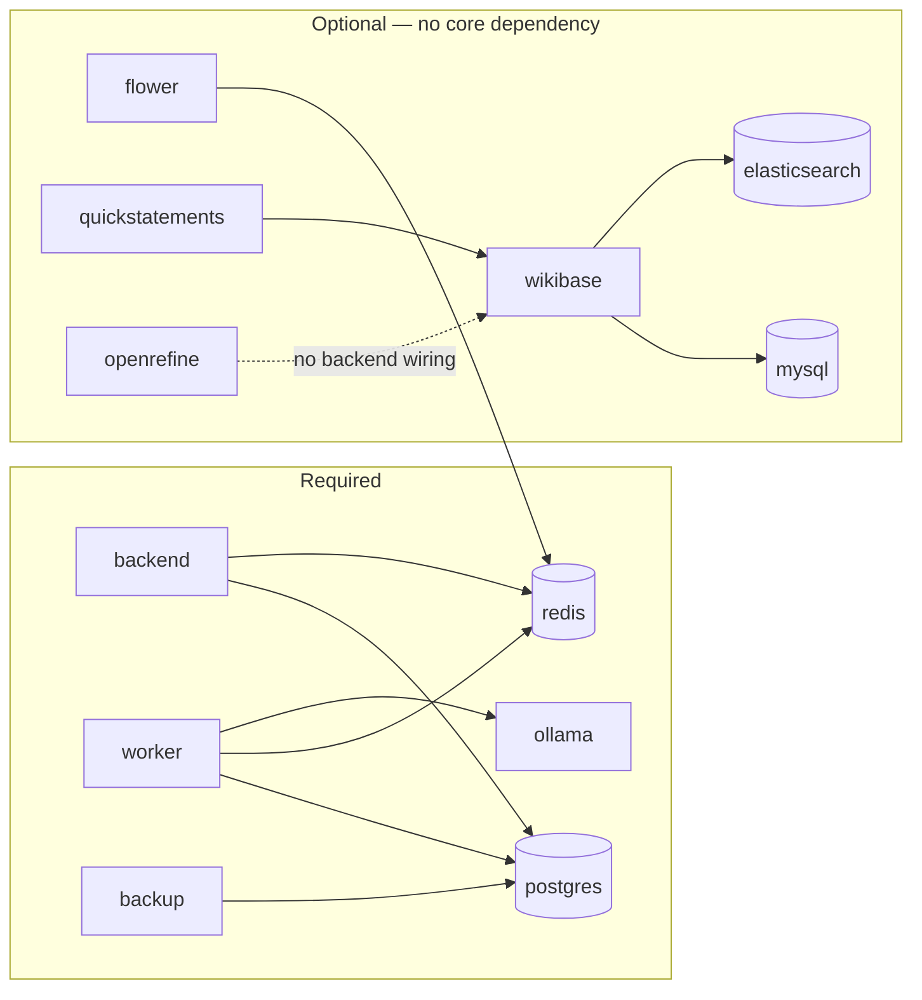

# Integrations and Service Groups

This document covers everything the application talks to that is not itself the application:
databases, brokers, inference, email, APM, the optional Wikibase stack, and the edge proxy. It also
records, honestly, which of these are required and which are not.

> **Rule of thumb:** if a service is listed as *non-essential* here, the core pipeline still works
> when it is stopped. If it is *core*, stopping it breaks upload, processing, or review.

---

## 1. Service groups

The 15 services in [`docker-compose.production.yml`](../../docker-compose.production.yml) fall into
three groups. Classification and memory figures come from
[`learnings/015`](../../learnings/015-service-inventory-and-gating.md), measured on the reference host.

| Group | Services | Idle memory | Required? |
| --- | --- | --- | --- |
| **Core** | `postgres`, `redis`, `ollama`, `backend`, `worker`, `frontend` | ~1,184 MiB | Yes — pipeline cannot run |
| **Core-adjacent** | `backup` | ~12 MiB | Yes — the only automated backup of `pgdata` |
| **Non-essential** | `wikibase`, `wikibase-jobrunner`, `wikibase-init`, `quickstatements`, `mysql`, `elasticsearch`, `openrefine`, `flower` | ~2,522 MiB | No — nothing in the pipeline depends on them |

Non-essential services therefore idle at roughly **16% of the reference host's RAM**. `openrefine`
(~1,084 MiB) and `elasticsearch` (~900 MiB) account for 79% of that.

`depends_on` only ever points inward (optional → core), never the reverse. That is what makes the
optional group safe to stop.

**Tesseract is not a service.** It is installed into the backend/worker image and spawned as a
subprocess per page, so there is no OCR daemon to start, stop, or monitor.

---

## 2. Gating status — recommended, not implemented

Stopping the optional group by hand is safe. Doing it *by configuration* is not implemented yet.

| Mechanism | State |
| --- | --- |
| `COMPOSE_PROFILES` | Verified end to end in `learnings/015`: with the variable empty only core services start; with it set, the named profile's services join |
| `profiles:` in `docker-compose.production.yml` | **Absent** — the optional services have no profile, so they always start |
| `profiles:` in `docker-compose.yml` (dev) | Present, but only under `monitoring` for the New Relic infrastructure agent |
| Runtime feature flags for the UI | Not viable as-is: `NEXT_PUBLIC_OPENREFINE_URL` and `NEXT_PUBLIC_WIKIBASE_URL` are inlined at **build** time, so hiding links requires a rebuild or a backend capabilities endpoint |

To gate in production you would add `profiles: [wikibase]` / `[openrefine]` / `[monitoring]` to the
relevant services and set `COMPOSE_PROFILES` in the environment tab. **Do not run `docker compose
down -v`** — the optional services hold named volumes, and `wikibase-init` re-creates properties on
next start, so the correct rollback is to leave volumes alone.

---

## 3. Core integrations

### PostgreSQL (`postgres`)

- **Image:** `pgvector/pgvector:pg16`
- **Role:** system of record for every table in [the data model](system-architecture.md#4-data-model)
- **Extensions:** `vector`, created by an Alembic migration before the `embeddings` table
- **Access:** `DATABASE_URL` — SQLAlchemy async engine over `asyncpg`
- **Health:** `pg_isready`; also asserted by `GET /api/health`
- **Volume:** `pgdata`
- **Migrations:** Alembic, run by the backend entrypoint before the app starts

### Redis (`redis`)

Four distinct jobs, which is why it is core rather than optional:

| Use | Key space / channel |
| --- | --- |
| Celery broker | `redis://redis:6379/0` |
| Celery result backend | `redis://redis:6379/1` |
| Rate-limit counters | `rate_limit:{scope}:{ip}` sorted sets |
| SSE fan-out | pub/sub channel consumed by `app/services/sse_service.py` |
| Per-book pipeline lock | managed by `app/tasks/pipeline_lock.py` |

- **Image:** `redis:7-alpine`, AOF enabled, `maxmemory 256mb`, `allkeys-lru`
- **Degradation:** if Redis is unreachable, the backend still serves requests — rate limiting is
  skipped and SSE clients receive nothing. Celery, however, cannot run without the broker.

### Ollama (`ollama`)

- **Role:** local LLM inference for metadata extraction. There is no external LLM provider in the
  request path; `OPENROUTER_API_KEY` exists only for offline evaluation scripts.
- **Default model:** `gemma4:e4b` (`DEFAULT_LLM_MODEL` in `app/core/config.py`)
- **Rollback model:** `phi4-mini`, kept as a `Modelfile` in `docker/Modelfile.phi4-mini`
- **Transport:** Ollama's native `/api/chat` is used for thinking models unconditionally, and for all
  models when `LLM_NATIVE_ENDPOINT=true`. The OpenAI-compatible `/v1` path drops `think:false` and
  makes thinking models return empty content.
- **Resource envelope:** `mem_limit: 9g`, `OLLAMA_MAX_LOADED_MODELS=1`, `OLLAMA_NUM_PARALLEL=1`,
  `OLLAMA_NUM_THREADS=3`, `OLLAMA_CONTEXT_LENGTH=4096`, `OLLAMA_KEEP_ALIVE=30m`
- **Health:** `ollama list`; also asserted by `GET /api/health`

> `learnings/015` records an earlier configuration (6 GB cap, `phi4-mini` preloaded). The compose file
> is authoritative and has since moved to `gemma4:e4b` with a 9 GB cap.

### Backup (`backup`)

- **Image:** `postgres:16-alpine` running `docker/scripts/backup-db.sh` in a 24-hour loop
- **Retention:** 7 daily dumps in the `backup_data` volume
- **Why ungated:** it costs ~12 MiB and is the only automated database backup. See
  [backup-and-recovery](../operations/backup-and-recovery.md).

---

## 4. Supporting integrations

### SMTP / Resend

- **Purpose:** email verification, password reset, and job-completion alerts
- **Transport:** `smtplib` in `app/services/email_service.py`, controlled by `SMTP_*` settings
- **Coupling:** in-app notifications are **never** gated by email settings; `users.email_notifications_enabled`
  only decides whether an alert email is also sent
- **Local development:** `SMTP_ENABLED=false` by default, so no mail is sent

### New Relic

- **Purpose:** APM for the backend and worker
- **Bootstrapping:** production runs under `newrelic-admin run-program`, which auto-instruments via
  `sitecustomize`. `main.py` therefore must **not** wrap the ASGI app again, or traces duplicate.
- **Explicit failure:** if `NEW_RELIC_ENABLED=true` and initialisation fails, the backend logs
  `critical` rather than silently producing no APM data
- **Browser agent:** `NEXT_PUBLIC_NEW_RELIC_*` are build-time arguments to the frontend image

### Flower

- **Purpose:** Celery task monitor
- **Access:** internal network only, `expose: 5555`, protected by `FLOWER_BASIC_AUTH`
- **Group:** non-essential

---

## 5. Optional integrations — Wikibase stack

These are documented as **optional and not enabled by default in practice**, even though they
currently start with the compose stack. Their purpose is to take a reviewed metadata record and
publish it as structured data.

| Service | Role |
| --- | --- |
| `wikibase` | MediaWiki + Wikibase entity store |
| `wikibase-jobrunner` | MediaWiki job queue worker |
| `wikibase-init` | One-shot: creates the properties the project needs |
| `quickstatements` | Batch statement import UI |
| `mysql` (MariaDB 10.11) | Wikibase's own database |
| `elasticsearch` | Wikibase search backend |
| `openrefine` | Bulk data cleaning GUI |

### What the application actually does with them

"Export to Wikibase" is **local**: `/api/bulk/export-wikibase` generates a QuickStatements TSV in the
backend and never contacts Wikibase over the network. The UI then links out to the hosted
QuickStatements/OpenRefine URLs.

### Known broken wiring

These are real defects, documented rather than glossed over:

1. **Property mapping never loads.** `docker/wikibase/create-properties.sh` writes
   `/config/property-mapping.json` into the `wikibase_config` volume, while the backend reads
   `PROPERTY_MAPPING_PATH` (default `/app/storage/property-mapping.json`) from `storage_data`. Because
   these are different volumes, `_load_property_mapping()` always falls back to hardcoded Wikidata
   P-IDs.
2. **`openrefine_service.py` is dead code.** Nothing imports it (verified: no importers in
   `backend/app`).
3. **The UI cannot be feature-flagged at runtime.** OpenRefine/Wikibase URLs are compiled into the
   client bundle, so a runtime flag will not hide the links.

None of these affect the core pipeline.

---

## 6. Edge and platform

| Component | Responsibility | Notes |
| --- | --- | --- |
| Cloudflare | DNS and TLS termination | Sets `CF-Connecting-IP`, which the rate limiter trusts first |
| Traefik (Dokploy) | Reverse proxy, path routing | Routes `/` → frontend and `/api` → backend on the **same** host so the session cookie is same-origin |
| Dokploy | Compose orchestration, environment injection, domains | Reads `docker-compose.production.yml`; environment tab is written into the project `.env` |

Both frontend and backend must be served from one origin. Splitting them would break cookie-based
sessions and CSRF, and would force `CORS_ORIGINS` to carry credentials across origins.

Hostnames, IPs and panel ports are deliberately **not** recorded here. They live in a gitignored
`infra/local/` because this repository is public.

---

## 7. Offline data sources (not runtime dependencies)

Several scripts under `backend/scripts/` fetch bibliographic reference data to build and verify
ground truth. None of them run in production.

| Source | Used by |
| --- | --- |
| Wikisource (Telugu, Hindi) | `fetch_wikisource_gt.py`, `fetch_from_wikisource.py` |
| Wikimedia Commons | `fetch_commons_ground_truth.py` |
| Wikidata | property/P-ID references, entity lookups |
| Open Library, Internet Archive | catalogue enrichment |
| OpenRouter | offline model comparison (`probe_openrouter_*.py`) |

---

## 8. Status summary

| Capability | Status |
| --- | --- |
| PostgreSQL + pgvector | Implemented |
| Redis (broker, results, rate limit, SSE, locks) | Implemented |
| Ollama extraction (`/api/chat`) | Implemented |
| SMTP email delivery | Implemented, disabled by default locally |
| New Relic APM (backend, worker, browser) | Implemented, opt-in |
| QuickStatements TSV export | Implemented, local generation only |
| Wikibase property mapping | **Broken** (volume mismatch) |
| OpenRefine backend integration | **Not implemented** (dead module) |
| Compose-profile gating | **Recommended, not implemented** |
| Runtime UI feature flags | **Not implemented** (build-time env only) |
| Semantic search over `embeddings` | **Not implemented** (schema only) |
