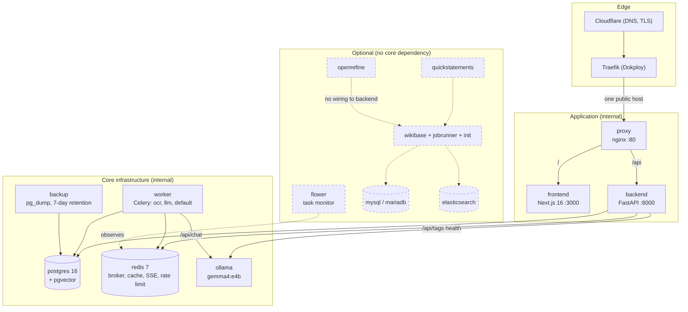
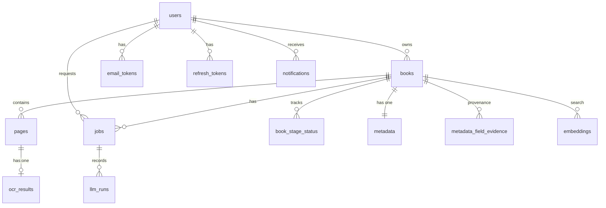
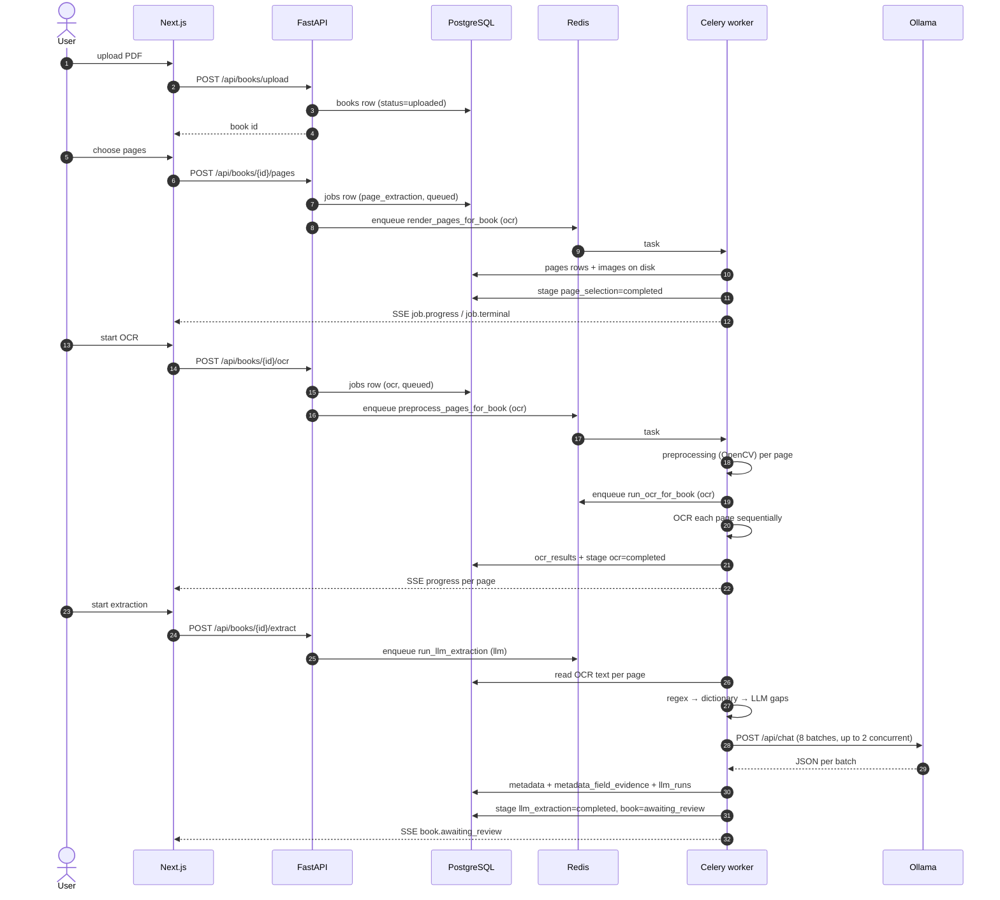

# System Architecture

This document describes how the Indic Book Metadata Extractor is put together: what runs, how a
request travels through it, what is stored, and how a book moves from upload to reviewed metadata.

It reflects the code on `main`. Where behaviour is limited or missing, it says so and links to
[known limitations](../known-limitations.md).

---

## 1. What the system does

A user uploads a scanned Indic book as a PDF. The system renders selected pages to images,
preprocesses them, runs optical character recognition, and extracts a 49-field bibliographic record
using a hybrid of deterministic extractors and a local LLM. A human reviews and corrects the result,
which can then be pushed to a Wikibase instance via OpenRefine/QuickStatements.

The pipeline is long-running and CPU-bound, so every expensive step is a background job rather than
an HTTP request. The browser follows progress over Server-Sent Events.

---

## 2. Runtime topology

All production services are defined in
[`docker-compose.production.yml`](../../docker-compose.production.yml) (16 services) and are reachable
only through the edge proxy. Only the `proxy` service is published to a domain; it routes `/` to the
frontend and `/api` to the backend. Everything else is on the internal network.



The optional cluster is documented separately in [integrations.md](integrations.md). Nothing in the
core pipeline depends on it, and it is not gated behind Compose profiles yet.

### Service responsibilities

| Service | Image | Responsibility | State |
| --- | --- | --- | --- |
| `proxy` | `nginx:1.27-alpine` | The only public entrypoint; routes `/` to the frontend and `/api/` to the backend on one origin | stateless |
| `frontend` | `Dockerfile.frontend` | Next.js App Router UI; the browser calls same-origin `/api`, which the proxy forwards | stateless |
| `backend` | `Dockerfile.backend` | HTTP API, auth, rate limiting, SSE hub, job reaper, maintenance state | stateless |
| `worker` | `Dockerfile.backend` (with `OCR_LINE=true`) | All Celery tasks: page rendering, preprocessing, OCR, LLM extraction | stateless |
| `postgres` | `pgvector/pgvector:pg16` | System of record for everything except files | `pgdata` |
| `redis` | `redis:7-alpine` | Celery broker, Celery result backend, rate-limit counters, SSE pub/sub | `redis_data` |
| `ollama` | `ollama/ollama` | Local inference for metadata extraction | `ollama_data` |
| `backup` | `postgres:16-alpine` | Daily `pg_dump`, retains 7 copies | `backup_data` |

**Important:** production runs a **single** `worker` container at `--concurrency=1` subscribed to
`ocr,llm,default`. The `ocr` and `llm` queues exist as separate routing targets, but one process
serves both, so a long OCR run and an LLM extraction cannot execute concurrently. This is a deliberate
resource decision on a CPU-only host, not an oversight — but it means queue separation is currently
logical, not physical. See [jobs-and-queues](../processing/jobs-and-queues.md).

---

## 3. Request path

The FastAPI application is assembled in [`backend/app/main.py`](../../backend/app/main.py). Middleware
is added in this order, which means it executes in the reverse order (last added is outermost):

```text
CORS  →  Maintenance  →  UploadSizeLimit  →  RateLimit  →  router  →  SecurityHeaders
```

| Layer | Behaviour |
| --- | --- |
| `CORSMiddleware` | Origins from `CORS_ORIGINS`; credentials allowed. Production is same-origin, so this mostly guards development. |
| `MaintenanceMiddleware` | Returns `503` for non-admin API traffic while maintenance mode is on, so maintenance state is not read from the database on every request. |
| `UploadSizeLimitMiddleware` | Rejects `POST /api/books/upload` from `Content-Length` before the multipart body is spooled to disk (`MAX_UPLOAD_SIZE_MB`, default 200). |
| `RateLimitMiddleware` | Redis sliding window: 60 req/min per client IP, 10 req/min on the five credential endpoints. Skipped for health, docs, thumbnails and SSE. |
| `add_security_headers` | HSTS, `nosniff`, `X-Frame-Options: DENY`, `frame-ancestors 'none'`, `Referrer-Policy`, `Permissions-Policy`. |

Client IP resolution prefers `CF-Connecting-IP`, then the **last** `X-Forwarded-For` hop. Earlier
hops are attacker-controlled.

### Router composition

Routers are mounted under `/api` in [`backend/app/api/router.py`](../../backend/app/api/router.py).
The ordering is load-bearing:

| Mount | Prefix | Auth |
| --- | --- | --- |
| `health` | `/api` | none — external monitors must be able to poll it |
| `media` | `/api` | session **or** signed token; ownership checked per handler |
| `auth` | `/api/auth` | none — pending/rejected users must be able to hold a session, refresh, and log out |
| `extraction` | `/api/books` | `require_approved_user` |
| `books` | `/api/books` | `require_approved_user` |
| `metadata` | `/api/books` | `require_approved_user` |
| `stages` | `/api/books` | `require_approved_user` |
| `pages` | `/api/pages` | `require_approved_user` |
| `jobs` | `/api/jobs` | `require_approved_user` |
| `bulk` | `/api/bulk` | `require_approved_user` |
| `dashboard` | `/api/dashboard` | `require_approved_user` |
| `sse` | `/api/sse` | `require_approved_user` |
| `notifications` | `/api/notifications` | `require_approved_user` |
| `admin` | `/api/admin` | `require_admin` inside the router |

`extraction` is mounted **before** `books` because its static sub-paths (for example
`/api/books/models`) would otherwise be captured by the `/{book_id}` route and fail UUID validation.

Interactive API docs (`/docs`, `/redoc`, `/openapi.json`) are disabled unless `DEBUG=true`, because
they enumerate the whole surface.

---

## 4. Data model

PostgreSQL holds all state. Images and PDFs live on a mounted volume, referenced by relative path.



| Table | Purpose | Notable columns |
| --- | --- | --- |
| `users` | Accounts, moderation state | `role`, `account_status`, `email_verified_at`, `token_version`, `email_notifications_enabled` |
| `refresh_tokens` | Rotatable sessions | `token_hash`, `expires_at`, `revoked_at`, `user_agent`, `ip_address` |
| `email_tokens` | Verification and reset tokens | `purpose`, `token_hash`, `expires_at`, `used_at` |
| `books` | One uploaded title | `status`, `language`, `owner_id`, `total_pages` |
| `pages` | Rendered page image | `page_number`, `image_path`, `processed_image_path`, `preprocessing_config`, `ocr_error` |
| `ocr_results` | OCR output per page | `raw_text`, `cleaned_text`, `corrected_text`, `bounding_boxes`, `confidence`, `ocr_engine`, `ocr_route`, `ocr_coverage`, `ocr_script` |
| `jobs` | Durable work record | `job_type`, `status`, `progress`, `celery_task_id`, `last_progress_at`, `error_log` |
| `llm_runs` | Audit of every LLM batch call | `model`, `prompt_template`, `batch_config`, `raw_response`, `parsed_fields` |
| `metadata` | The extracted record | `fields` (JSONB) — the whole 50-field object |
| `metadata_field_evidence` | Per-field provenance | `field_name`, `value`, `confidence`, `extraction_method`, `source_page_number`, `source_text_snippet` |
| `book_stage_status` | Append-only stage history | `stage_name`, `attempt`, `status`, `started_at`, `completed_at`, `error_log` |
| `notifications` | In-app alerts | `type`, `title`, `body`, `read_at` |
| `system_settings` | Runtime toggles | maintenance mode and related flags |
| `embeddings` | Reserved for semantic search | `embedding vector(768)`, `source_text` |

Migrations are Alembic, 20 revisions, under [`backend/alembic/versions/`](../../backend/alembic/versions).
The `vector` extension is created by a migration before the embeddings table.

### Two parallel state machines

This is the single most important thing to understand about the data model. Book progress is tracked
**twice**, and the two mechanisms answer different questions.

**`books.status`** — a denormalised convenience value for list views and polling.

```text
uploaded → pages_selected → ocr_running → ocr_complete → llm_running → awaiting_review → complete
```

**`book_stage_status`** — an append-only audit trail with one row per `(book, stage, attempt)`.

```text
upload → page_selection → ocr → llm_extraction → human_review → completion
```

Each stage row moves `initiated → processing → completed | failed | cancelled`. `StageManager` derives
`books.status` from the stage rows and enforces that a stage may only start after its predecessor
reached a terminal state. Books created before stage tracking existed have no stage rows and are
treated as legacy: the sequential check is skipped so they are not locked out of the pipeline.

Re-running an upstream stage calls `reset_from_stage`, which cancels that stage and every stage after
it, then initiates a fresh attempt. This is why `attempt` exists — history is never rewritten.

---

## 5. Processing pipeline



### Stage-by-stage

| Stage | Entry point | What happens | Failure handling |
| --- | --- | --- | --- |
| Upload | `POST /api/books/upload` | PDF stored as `uploads/{book_id}/original.pdf`; size capped before spooling | 413 before write |
| Page selection | `POST /api/books/{id}/pages` | `render_pages_for_book` renders only the requested pages at the configured DPI. Idempotent: re-rendering a page overwrites its row. | Per-page errors are collected; zero pages rendered is a failed stage, partial success completes |
| Auto-selection | `page_selection.select_pages` | Heuristic: keep front/back matter until a "body page" is detected (long text, many lines, no cue words). A `fixed` strategy is also available. | Not on the upload path by default |
| Preprocessing | `preprocess_pages_for_book` | Applies per-page `preprocessing_config`; chains to OCR. Only pages with a config **and** no existing `processed_image_path` are processed. | Failure marks the job failed and does **not** dispatch OCR |
| OCR | `run_ocr_for_book` | Sequential per page: `ocr_service.process_page_image` → low-confidence retry → normalisation. Partial failure still completes the stage. | Only an all-pages-failed run fails; per-page errors recorded on `pages.ocr_error` |
| Extraction | `run_llm_extraction` | Hybrid: regex → dictionary → LLM for remaining gaps, 8 batches. Writes metadata, evidence, and one `llm_runs` row per batch. | All batches failed → failed; partial → completed with `error_log` |

### Job lifecycle

Every long task is represented by a `jobs` row created by the API **before** dispatch, so the UI has
something to poll and the worker has something to update.

```text
queued → running → completed
                 ↘ failed
                 ↘ cancelled
```

Reliability properties, all configured in [`backend/app/tasks/celery_app.py`](../../backend/app/tasks/celery_app.py):

| Property | Value | Why |
| --- | --- | --- |
| `task_acks_late` | `true` | A task that kills the worker is redelivered rather than lost |
| `task_reject_on_worker_lost` | `true` | Same, for hard worker death |
| `worker_prefetch_multiplier` | `1` | No task hoarding on a single-concurrency worker |
| `result_expires` | 3600 | Results are informational; the `jobs` row is the truth |
| `max_retries` | 3 (2 for preprocessing/render) | Transient network/DB only |

Three independent guards prevent a stuck book:

1. **`single_book_task`** ([`pipeline_lock.py`](../../backend/app/tasks/pipeline_lock.py)) — a **single
   global** Redis lock (`pipeline:single-book`, 300 s TTL, refreshed as work progresses) so only one
   book is processed at a time. On a 4 vCPU / no-swap host, two concurrent books oversubscribe the
   CPU and make both slower. The lock fails **open** when Redis is unavailable.
2. **Supersede checks** ([`cancellation.py`](../../backend/app/tasks/cancellation.py)) — a task that lost
   its book to a newer run stops writing results instead of clobbering them.
3. **Job reaper** ([`job_reaper.py`](../../backend/app/services/job_reaper.py)) — a backend loop every 300s
   fails any `running` job with no recent `last_progress_at` (default threshold 90 minutes), so a lost
   worker cannot leave a book permanently `ocr_running`.

Celery signal handlers additionally reconcile `jobs` rows on `task_failure` and `task_revoked`, so
"task died" never leaves a job `running` in the database.

---

## 6. ASGI lifespan and background loops

`main.py` starts four things and stops them in reverse on shutdown:

| Task | Interval | Purpose |
| --- | --- | --- |
| Redis pool | once | Rate limiting, SSE pub/sub. Failure degrades gracefully — rate limiting is skipped |
| `sse_service.start(pool)` | once | Subscribes to the Redis channel that workers publish to |
| `_maintenance_loop` | 10s | Reconciles the maintenance snapshot with the database and Redis |
| `_reaper_loop` | 300s | Fails stale jobs (disabled when `stale_job_reaper_enabled=false`) |

The application refuses to start in non-debug mode with a `JWT_SECRET_KEY` shorter than 32 characters.

---

## 7. Storage layout

Files are stored under `STORAGE_PATH` (default `/app/storage`, the `storage_data` volume) and
referenced by **relative** path so the database is portable across hosts.

```text
storage/
├── uploads/{book_id}/original.pdf
├── pages/{book_id}/p0001.png              # full render, source for preprocessing
├── processed/{book_id}/p0001_processed.png # preprocessing output
├── thumbnails/{book_id}/p0001.jpg
├── thumbnails/{book_id}/previews/p0001_w1200.jpg  # cached wide previews
├── models/telugu-ocr-ft/                  # fine-tuned checkpoint, if present
└── property-mapping.json                  # Wikidata P-ID → local P-ID map
```

`storage.relative()` refuses to return a path outside the storage root, so a crafted book id cannot
escape the volume.

---

## 8. Authentication and authorisation

Full detail is in [authentication.md](../application/authentication.md). The architecture-level facts:

- **Sessions are cookies**, not bearer tokens in local storage: `access_token` (15 min, JWT HS256) and
  `refresh_token` (7 days, opaque, hashed in `refresh_tokens`).
- **CSRF** is enforced for cookie-authenticated mutations using a double-submit cookie (`csrf_token`
  plus `X-CSRF-Token`), compared with `hmac.compare_digest`.
- **Passwords** are Argon2 hashes; rehash-on-login is supported.
- **Revocation** works through `users.token_version`, embedded in the JWT as `tv`. Bumping it
  invalidates every outstanding access token for that user.
- **Verification is mandatory**: a token whose user has no `email_verified_at` is rejected.
- **Approval is a separate gate**: `require_approved_user` is an allow-list on `account_status ==
  approved`. Pending and rejected users hold a valid session but can only reach `/api/auth/*`.
- **Ownership is checked per resource** and failures return **404, not 403**, so the existence of
  another user's book is not confirmed.

---

## 9. Observability

| Signal | Where |
| --- | --- |
| Liveness/readiness | `GET /api/health` — checks PostgreSQL, Redis and Ollama; returns 503 when any is down |
| Job progress | SSE `job.progress` events plus `jobs.progress` |
| Task tracking | Flower on the internal network (`FLOWER_BASIC_AUTH` required) |
| APM | New Relic, backend and worker, enabled by `NEW_RELIC_ENABLED` |
| Metrics | `app/services/metrics.py` records OCR completion, confidence and duration |
| Errors | Structured logging via `app/core/logging_config.py`; global handlers normalise error bodies to `{detail, type}` |

---

## 10. Known architectural limitations

Documented here because they shape what the documentation can honestly promise:

1. **CPU-only inference.** Extraction on the reference host takes minutes per book; the pipeline is
   not interactive at the LLM stage.
2. **One worker, one slot.** `ocr` and `llm` queues share a single `concurrency=1` process, so stages
   serialise even across different books.
3. **Language coverage is narrow.** Telugu and Hindi are supported and evaluated; other Indic scripts
   are not.
4. **No authentication on the optional stack.** Wikibase/Traefik exposure is an operational concern
   tracked in [integrations.md](integrations.md).
5. **Semantic search is not implemented.** The `embeddings` table and pgvector extension exist, but
   nothing writes embeddings or queries them.
6. **Optional services are not gated.** They always start with the compose stack and idle at roughly
   2.5 GiB.
