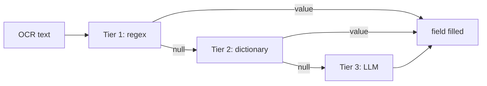

# Metadata Extraction

Extraction turns OCR text into a 49-field bibliographic record. It is a **hybrid**: cheap
deterministic extractors run first, and the LLM is asked only for the fields still missing.

- Orchestrator: `backend/app/services/extractors/hybrid.py`
- LLM client: `backend/app/services/llm_service.py`
- Prompt rendering: `backend/app/services/prompts.py`, `prompt_profiles.py`
- Batch/page routing: `backend/app/services/batch_routing.py`
- Task and persistence: `backend/app/tasks/llm_tasks.py`
- Schema: `backend/app/schemas/metadata.py`

---

## 1. The field schema

49 standard fields plus `custom_fields`, grouped into **8 batches**. Each batch is a Pydantic model,
so a batch reply is schema-validated before anything is stored.

| Batch | Fields | Typical source pages |
| --- | --- | --- |
| `core_identity` | 9 — label, author, descriptions, languages, isbn, title, subtitle | title page |
| `contributors` | 8 — translator, editor, compiler, cover artist, designer, typesetting, typing, book designer | title page, colophon |
| `publication` | 8 — publication_date, publisher, publisher_telugu, place_of_publication, printer, place_of_printing, distributors, sponsor | copyright page, colophon |
| `content_classification` | 6 — form_of_creative_work, genre, subject, inception, context, awards | title page, cover |
| `edition_series` | 6 — volume, edition_number, edition_or_translation_of, part_of_series, serial_number_in_series, part_of_the_set | title page, copyright |
| `relationships` | 3 — based_on, inspired_by, first_published_in | title page, colophon |
| `ancillary_content` | 7 — dedication, dedication_verbatim, forewords, abbreviations, authors_in_compilation, opinions_messages, scribes | dedication, foreword, back matter |
| `physical_extra` | 2 — pages, illustrators | anywhere |

Full field list and descriptions: [metadata-fields](../reference/metadata-fields.md).

Batches exist because a single 49-key prompt on a 4B model degrades badly. Splitting keeps each
request small enough for `num_ctx=4096` and lets page routing target each batch's likely location.

---

## 2. Hybrid tiers



A field is escalated only when the previous tier returned nothing. Tiers run in order, never in
parallel.

### Tier 1 — regex (`extractors/regex_extractors.py`)

| Field | Method |
| --- | --- |
| `isbn` | ISBN-10/13 pattern with hyphen tolerance |
| `publication_date` | four-digit year extraction |
| `pages` | printed page-count patterns |

### Tier 2 — dictionary (`extractors/dictionary_extractors.py`)

| Field | Method |
| --- | --- |
| `publisher` | Known-publisher dictionary match |
| `language` | Script-based language detection |

**5 fields are deterministic; the remaining 44 go to the LLM.**

> The module docstring in `hybrid.py` mentions an NER tier between dictionary and LLM. **No NER
> registry exists** — only `REGEX_REGISTRY` and `DICT_REGISTRY` are consulted. Treat NER as
> unimplemented.

Every tier logs how many fields it resolved, so "0 fields extracted" can be diagnosed as an OCR
problem, a rule problem, or an LLM problem rather than guessed at.

---

## 3. Per-batch page routing

Feeding every batch the same truncated blob wasted most of the budget on the title page and made
back-matter fields unreachable. `batch_routing.py` picks a page window per batch instead.

| Batch | Front slice | Plus back slice |
| --- | --- | --- |
| `core_identity` | first 3 pages | — |
| `contributors` | first 3 pages | — |
| `publication` | first 4 pages | last 3 |
| `content_classification` | first 3 pages | — |
| `edition_series` | first 4 pages | last 3 |
| `relationships` | first 8 pages | last 3 |
| `ancillary_content` | first 5 pages | last 3 |
| `physical_extra` | all pages | — |

Slices are positional, not content-classified. If a slice is empty (short book), the whole page list is
used instead, so no batch is ever starved.

Assembly rules (`assemble_ocr_text`):

- Each page contributes `max_chars // page_count` characters, so a 10-page slice does not shrink to
  nothing.
- Pages are joined with `---` and prefixed `[Page N]` so the model can cite provenance.
- The whole string is truncated at a whitespace boundary with a ` ...` marker.

Per-batch budget: `MAX_OCR_CHARS = 2500`.

---

## 4. LLM call

| Setting | Value |
| --- | --- |
| Default model | `gemma4:e4b` (`DEFAULT_LLM_MODEL`) |
| Temperature | `0.3` |
| Max tokens | `512` |
| Max parallel batches | `2` (`MAX_PARALLEL_BATCHES`) |
| Native timeout | `1200 s` |
| Native attempts | `2` |
| Circuit breaker | opens after `3` consecutive failures |

### Transport selection

| Model / setting | Endpoint |
| --- | --- |
| Thinking model (any), or `LLM_NATIVE_ENDPOINT=true` | Ollama native `/api/chat` |
| Otherwise | OpenAI-compatible `/v1` via Instructor |

Thinking models **must** use `/api/chat`: the `/v1` path drops `think:false`, so they emit reasoning
tokens into the content field and return empty or invalid JSON.

The native path posts to `/api/chat` directly with `think: false`, retries once, and parses JSON
itself. The `/v1` path delegates schema validation to Instructor.

### Failure handling per batch

| Condition | Job outcome |
| --- | --- |
| All batches failed | `failed`, `error_log = "All batches failed: …"` |
| Some batches failed | `completed`, `error_log = "Partial failures: …"` |
| All batches returned empty | `completed` with an explanatory `error_log` |
| Some empty batches | `completed`, logged at info |

An all-null batch is a **valid answer** when those fields are absent from the book. It is not treated
as an error, which is why the distinction between "empty" and "failed" exists in the usage record.

---

## 5. Prompts and profiles

Prompts live in `prompt_profiles.py` so experiments and production share one source.

- **Default profile:** `V00` (`DEFAULT_PROMPT_PROFILE`), byte-identical to pre-experiment production.
- **Registered profiles:** `V00`–`V12`, each isolating one technique — role tightening, strict
  verbatim, OCR-noise boundary, script policy, context precedence, null discipline, schema-driven
  output, evidence grounding, explicit missing-field handling, per-field guidance, real few-shot
  exemplars, conflict policy.
- **Stage-3 combinations** (`V13`+) are built by `combination_profile()` from measured winners, not
  guessed.

Render precedence:

```text
user override  >  requested profile  >  DEFAULT_PROMPT_PROFILE
```

A custom prompt from the LLM-config screen therefore always wins, and no experimental profile can leak
into the app unless `DEFAULT_PROMPT_PROFILE` is changed deliberately.

Few-shot examples are synthetic by default. The `real` source loads held-out ground-truth exemplars
from `backend/prompt_eval/fewshot/`, falling back to no examples rather than failing.

---

## 6. Persistence

`_persist_extraction_results` writes, in one transaction:

1. **`metadata.fields`** — the full 50-key object. `SELECT … FOR UPDATE` so a user edit made during
   extraction is not silently overwritten.
2. **`metadata_field_evidence`** — one row per populated field, with confidence, extraction method,
   source page and snippet. Rows for fields the new run did not populate are deleted, so the UI cannot
   show a stale confidence.
3. **`llm_runs`** — one row per batch, with the exact prompt, model, raw response and parsed fields.

### Re-run semantics

| Field class | Behaviour on re-run |
| --- | --- |
| Standard fields | **Replaced**. A value not found this time becomes `null`. |
| `custom_fields` | **Preserved**. User-added keys survive. |

That asymmetry is intentional: a stale extracted value is worse than a missing one, but a user's
custom field is never the model's to delete.

### Stage transition

The stage write happens on the **same session** as the metadata write. A second session asking
`FOR UPDATE` on the book would block against this transaction's foreign-key locks and deadlock.

If the stage was already terminal (a newer run won), `StageTransitionError` is caught: the job logs it
and keeps its result, or rolls back entirely if it was superseded.

---

## 7. Progress and notifications

Each completed batch updates `jobs.progress` and publishes SSE `job.progress` with the batch name. On
completion the task publishes `job.terminal`, `book.status_changed`, and — when the book reaches
`awaiting_review` — `book.awaiting_review` with a low-confidence field count
(`LOW_CONFIDENCE_THRESHOLD`, default `0.55`).

Notifications are created through `notification_service` and mirrored to email only when the user has
`email_notifications_enabled`.

---

## 8. Evaluation (separate from runtime)

`services/extraction_validator.py` scores predictions against ground truth. It is **not** part of the
request path.

Two scoring tracks that must not be confused:

| Track | Question |
| --- | --- |
| **presence** (`tp`/`fp`/`fn`, `micro_*`, `per_field_f1`) | "did the model fill the field at all" |
| **value** (`value_*`, `field_level_accuracy`) | "is the value correct" |

Masks exclude fields the model could not reasonably extract:

| Mask | Meaning |
| --- | --- |
| `visible` | in the supplied text — must be extracted |
| `absent` | not in the text — a value is a hallucination |
| `unroutable` | in the book but outside this batch's pages (a routing defect) |
| `not_in_scan` | nowhere in the cached text, usually catalogue-derived |
| `script_mismatch` | ground truth is in a different script from the scan |

Identifiers (`isbn`, `pages`, `publication_date`, `edition_number`, `volume`,
`serial_number_in_series`, `part_of_the_set`, `inception`) never receive fuzzy credit — a truncated
year is a wrong answer.

See [evaluation](../testing/evaluation.md) for corpora and reported numbers.

---

## 9. Limitations

1. **`gemma4:e4b` is a small model.** Expect misses on rare fields; the evidence table is what makes
   them visible rather than invisible.
2. **2,500 characters per batch** means a field printed on an unrouted page is unreachable. That is
   what the `unroutable` mask measures.
3. **No few-shot retrieval per book.** Exemplars are chosen by language and batch, not by similarity.
4. **No cross-batch conflict resolution at runtime.** The `conflict_policy` prompt profile exists, but
   the merger does not arbitrate between batches.
5. **Custom fields are never extracted**, only preserved.
6. **Single model, no fallback chain.** If Ollama is down, extraction fails after retries.

