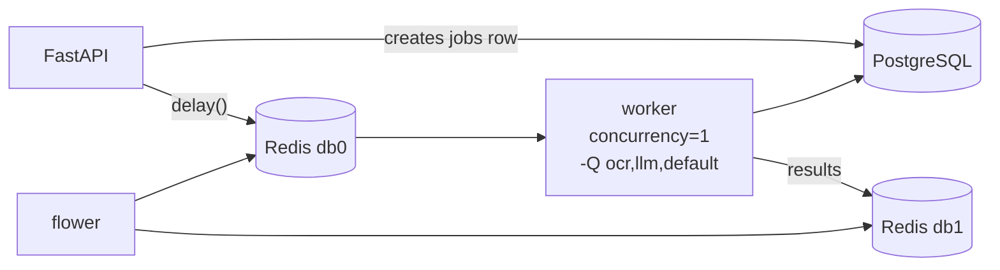
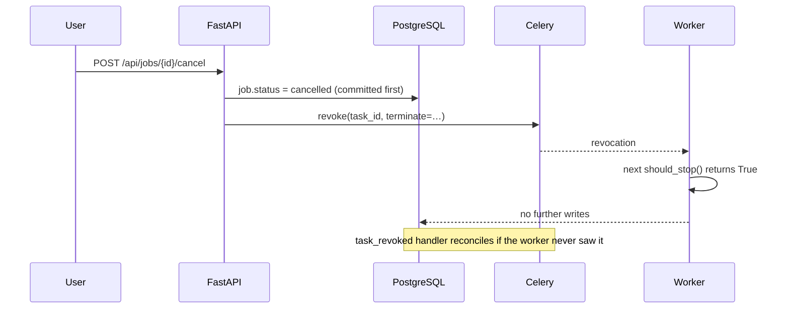

# Jobs, Queues and Recovery

Everything expensive runs in Celery. This document covers the task topology, the guarantees around
each task, and the three independent mechanisms that prevent a book from getting stuck.

- App and signals: `backend/app/tasks/celery_app.py`
- Lock: `backend/app/tasks/pipeline_lock.py`
- Cancel/supersede checks: `backend/app/tasks/cancellation.py`
- Reaper: `backend/app/services/job_reaper.py`

---

## 1. Topology



| Item | Value |
| --- | --- |
| App name | `indic_books` |
| Broker | `REDIS_URL` → db 0 |
| Result backend | `CELERY_RESULT_BACKEND` → db 1 |
| Registered modules | `app.tasks.ocr_tasks`, `app.tasks.llm_tasks`, `app.tasks.page_tasks` |
| Production worker | one container, `--concurrency=1`, `-Q ocr,llm,default` |

The `ocr` and `llm` queues are separate **routing targets**, but a single worker process serves both.
A long OCR run and an extraction therefore cannot run at the same time. This is a deliberate
CPU-budget decision, not an oversight.

---

## 2. Task catalog

| Task | Queue | Retries | Delay | Notes |
| --- | --- | --- | --- | --- |
| `render_pages_for_book` | `ocr` | 2 | 15 s | Renders selected pages |
| `preprocess_pages_for_book` | `ocr` | 2 | 15 s | Chains to `run_ocr_for_book` |
| `apply_preprocessing_bulk` | `ocr` | 1 | 15 s | One config, every page |
| `run_ocr_for_book` | `ocr` | 3 | 30 s | Auto-retries transient errors |
| `run_llm_extraction` | `llm` | 3 | 60 s | 8 batches per book |

Every task is `bind=True`, `acks_late=True`, and decorated with `@single_book_task`.

Retries are reserved for **transient** failures. The retryable set is
`ConnectionError`, `TimeoutError`, `OSError`, `sqlalchemy.exc.OperationalError` / `DBAPIError`.
Validation failures, bad status, and missing files fail immediately — retrying them would only delay
the error.

---

## 3. Reliability configuration

| Setting | Value | Why |
| --- | --- | --- |
| `task_acks_late` | `true` | A task that kills the worker is redelivered, not lost |
| `task_reject_on_worker_lost` | `true` | Covers hard worker death, not just exceptions |
| `worker_prefetch_multiplier` | `1` | No task hoarding on a single-concurrency worker |
| `task_track_started` | `true` | `STARTED` state is visible to Flower |
| `result_expires` | 3600 | Results are informational; the `jobs` row is truth |

---

## 4. The three guards

### Guard 1 — single global pipeline lock

```python
LOCK_KEY = "pipeline:single-book"
LOCK_TTL_SECONDS = 300
```

`@single_book_task` wraps every pipeline task:

1. `SET NX EX 300` with the job id as the owner value.
2. If the lock is held, `self.retry(countdown=15, max_retries=720)` — roughly three hours of waiting.
3. The lock is refreshed on every progress update (`pipeline_lock.refresh`).
4. Release is a Lua compare-and-delete, so a task can only release its own lock.

This is a **global** lock, not per book. On a 4 vCPU / 16 GB no-swap host, two concurrent books
oversubscribe the CPU and make both slower.

**It fails open.** If Redis is unreachable, `acquire()` returns `True` and the task proceeds. Losing
serialisation is preferable to stalling the entire pipeline.

### Guard 2 — cancel and supersede checks

| Helper | Question |
| --- | --- |
| `is_cancelled_async(db, job_id)` | Is the job cancelled, or does its row no longer exist? |
| `is_superseded_async(db, job)` | Does a **newer** job of the same type exist for the same book? |
| `should_stop(job_id)` | Synchronous one-query combination of both |

Supersession is defined by `created_at`: a newer row with the same `book_id` and `job_type` means the
older task must not write anything. A re-run therefore cannot be corrupted by a zombie worker that
finishes late.

Tasks check these **before each unit of work** and **immediately before writing a terminal status**.

### Guard 3 — job reaper

A backend loop, every 300 s, independent of Celery:

```python
cutoff = now - timedelta(minutes=STALE_JOB_MINUTES)   # default 90
jobs   = running jobs where coalesce(last_progress_at, started_at) < cutoff
```

For each: mark `failed`, release the book, fail the stage, notify the owner.

`last_progress_at` is the liveness signal — a long but healthy extraction keeps refreshing it, so a
slow job is not mistaken for a lost one. Releasing the book matters as much as failing the job: both
`run_ocr_for_book` and `run_llm_extraction` refuse to start from a running status, so a wedged
`llm_running` book would be a dead end with no UI action able to clear it.

Book release is stage-aware (`_release_book`):

| Job type | Book status reset to |
| --- | --- |
| `llm` | `ocr_complete` |
| `ocr`, `preprocessing` | `pages_selected` |

---

## 5. Celery signal handlers

`celery_app.py` registers handlers so the database always reflects reality, even when the task body
never ran its own error path.

| Signal | Action |
| --- | --- |
| `worker_init` | Safety-net New Relic init when `sitecustomize` was not injected |
| `task_failure` | Look up `jobs` by `celery_task_id`; skip if terminal or superseded; mark failed; fail the `ocr` stage; create notification; publish `job.terminal` |
| `task_revoked` | Mark job cancelled; cancel the mapped stage if still `processing`/`initiated`; log defensively |
| `task_rejected` | Log only — Celery re-queues via `task_reject_on_worker_lost` |

The job→stage mapping used on revocation (`_JOB_STAGE_NAME`):

| Job type | Stage |
| --- | --- |
| `page_extraction` | `page_selection` |
| `preprocessing` | `ocr` |
| `ocr` | `ocr` |
| `llm` | `llm_extraction` |

These handlers exist because cancellation normally commits the `cancelled` row *before* revoking, so
the handler is a defensive net for revokes from broker restarts or operator tooling.

---

## 6. Progress semantics

Progress updates are conservative on purpose:

```python
job = SELECT … FOR UPDATE
job.last_progress_at = now
if new_progress > (job.progress or 0.0):
    job.progress = new_progress
```

- The row lock serialises concurrent updates.
- Progress **never regresses**, even if tasks complete out of order.
- `last_progress_at` advances on every update, which is what keeps the reaper from firing.

Progress is best-effort: a failed update is logged at debug and never fails the task.

---

## 7. Cancellation flow



The database is the source of truth. A worker that has already passed `should_stop()` may still be
mid-page; it will exit at the next check and its terminal write is gated by the same check.

---

## 8. Idempotency

Several mechanisms make retries and re-deliveries safe:

| Mechanism | Protects against |
| --- | --- |
| Page upsert by `(book_id, page_number)` | Duplicate pages from a redelivered render task |
| `ocr_results` unique on `page_id` | Duplicate OCR rows |
| `metadata` unique on `book_id` | Duplicate metadata rows |
| `metadata_field_evidence` unique on `(book, field, method)` | Duplicate evidence |
| `notifications` unique on `(user_id, event_key)` | Duplicate alerts from at-least-once delivery |
| `book_stage_status` terminal checks | Double transitions into the same state |
| Supersede checks | A stale task overwriting a newer run |

---

## 9. Operational notes

- **Workers send email.** They need the same `SMTP_*` and `FRONTEND_URL` as the backend, because job
  notifications originate in the task.
- **Flower is internal.** `expose: 5555`, protected by `FLOWER_BASIC_AUTH`, non-essential.
- **`result_expires` is one hour.** Do not build monitoring on Celery results; poll `jobs`.
- **No result backend dependency.** If Redis db 1 is lost, tasks still run; only historical results
  disappear.
- **Adding a task:** register its route in `task_routes`, decorate with `@single_book_task`, include
  the module in `celery_app.include`, and document its retry policy here.

---

## 10. Limitations

1. **Global serialisation.** Two users cannot process books concurrently, regardless of capacity.
2. **No priority queues.** A queued extraction waits behind any queued OCR job.
3. **No dead-letter queue.** Failures are terminal in `jobs`, with the error text as the record.
4. **The 15 s lock-retry loop can hold a task for ~3 hours**, which is intentional but means a stuck
   lock delays rather than fails work.
5. **`terminate=…` cannot interrupt a C-extension call.** Tesseract on a huge page may run to
   completion before the cancellation is observed.

