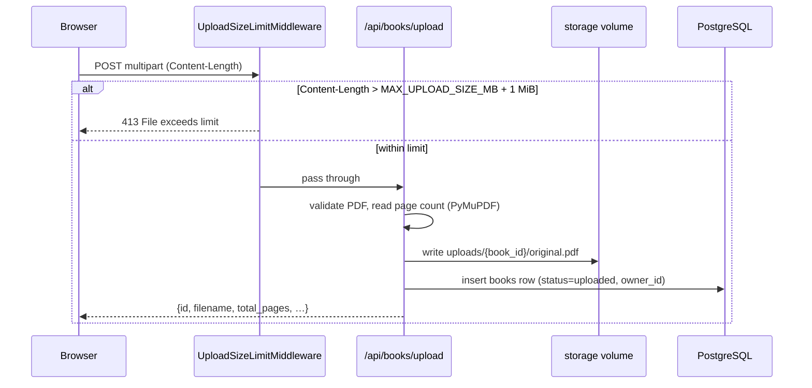

# PDF Upload and Page Rendering

Covers what happens between a user choosing a PDF and having page images on disk ready for
preprocessing.

- Upload: `backend/app/api/books.py`
- Rendering task: `backend/app/tasks/page_tasks.py`
- PDF primitives: `backend/app/services/pdf_service.py`
- Storage paths: `backend/app/services/storage.py`
- Page selection: `backend/app/services/page_selection.py`

---

## 1. Upload

`POST /api/books/upload` (multipart, `require_approved_user`).



Two-layer size protection:

| Layer | When | Behaviour |
| --- | --- | --- |
| `UploadSizeLimitMiddleware` | Before Starlette spools the multipart body to disk | 413 from `Content-Length`; allows 1 MiB of multipart envelope headroom |
| Upload handler copy loop | Bodies without `Content-Length` (chunked) | Caps the bytes copied |

The middleware exists because Starlette parses and spools the part **before** the route runs, so a
handler-level check would be too late to protect the disk.

After a successful upload the book is in `uploaded` with no pages. Nothing is rendered yet — the user
chooses pages first.

---

## 2. Page selection

The UI shows thumbnails and the user picks pages. Two strategies exist in `page_selection.py`:

### `fixed`

Keep the first `front` pages and the last `back` pages. Simple and predictable.

### `heuristic` (default)

Keep front and back matter, stop at the first *body page*:

```python
def is_body_page(text):
    lines = [ln for ln in text.splitlines() if ln.strip()]
    return len(text) > 1200 and len(lines) > 14 and not CUE.search(text)
```

`CUE` matches bibliographic markers in Telugu, Devanagari and English: `ప్రచురణ`, `ముద్రా`,
`సంవత్సర`, `ప్రకాశక`, `प्रकाशक`, `मुद्र`, `©`, `(c)`, `copyright`, `isbn`, `press`, `printed`,
`publisher`, `registered`.

Front matter is collected from the start until a body page appears; back matter from the end,
symmetric. This avoids feeding hundreds of body-text pages into the extraction prompt.

> **Status:** the heuristic needs OCR text to classify a page, so it is a post-OCR utility used by the
> evaluation harness and the metadata-window work, not something the upload flow depends on. The
> production path renders whatever pages the user selected. See
> [`plans/009`](../../plans/009-metadata-page-selection.md) for the POC and its labelling caveat.

---

## 3. Rendering task

`POST /api/books/{book_id}/pages` creates a `page_extraction` job and enqueues
`render_pages_for_book` on the `ocr` queue.

Rendering used to run synchronously inside the HTTP request, which blocked for the whole render and
offered no progress or cancel. It is now a job.

```text
for each requested page number:
    if cancelled or superseded → stop
    render full page at OCR_RENDER_DPI → pages/{book_id}/pNNNN.png
    upsert pages row
    update progress (never decreases) + SSE
finalise
```

### Rendering parameters

| Parameter | Source | Default |
| --- | --- | --- |
| DPI | `OCR_RENDER_DPI` | 300 |
| Zoom matrix | `dpi / 72` | — |
| Alpha | disabled (`alpha=False`) | — |
| Format | PNG | — |

PyMuPDF (`fitz`) opens the document once per page in `render_full_page`, always inside `try/finally`
so a corrupt PDF cannot leak a file handle.

### Page upsert

Rendering is idempotent. For an existing `(book_id, page_number)`:

| Column | Behaviour |
| --- | --- |
| `image_path` | overwritten |
| `preprocessing_config` | reset to `DEFAULT_PREPROCESSING_CONFIG` |
| `processed_image_path` | **cleared**, forcing preprocessing to re-run |

That last one matters: re-rendering at a different DPI invalidates any previously processed image.

### Finalisation

| Condition | Result |
| --- | --- |
| `page_count == 0` | Job failed, stage `page_selection` failed, per-page errors collected |
| `page_count > 0` | Job completed (even with some page errors logged), `book.status = pages_selected`, stage `page_selection` completed |

---

## 4. Thumbnails and previews

| Artefact | Size | Path |
| --- | --- | --- |
| Thumbnail | 180 px wide | `thumbnails/{book_id}/pNNNN.jpg` |
| Wide preview | requested width | `thumbnails/{book_id}/previews/pNNNN_w{width}.jpg` |
| Full render | `OCR_RENDER_DPI` | `pages/{book_id}/pNNNN.png` |
| Processed | full | `processed/{book_id}/pNNNN_processed.png` |

`render_all_thumbnails` renders every page in **one open/close cycle**, which is substantially faster
than opening the PDF per page. Wide previews are cached by width so the zoomable viewer does not
re-render on every interaction.

Thumbnail and preview URLs carry a signed, resource-scoped token (see
[authentication](../application/authentication.md#8-media-access-without-cookies)), and thumbnail GETs
are exempt from rate limiting because they serve cached static files.

---

## 5. Storage contract

All paths stored in the database are **relative** to `STORAGE_PATH`:

```text
uploads/{book_id}/original.pdf
pages/{book_id}/p0001.png
processed/{book_id}/p0001_processed.png
thumbnails/{book_id}/p0001.jpg
thumbnails/{book_id}/previews/p0001_w1200.jpg
```

`storage.relative()` resolves the path and raises if it escapes the storage root, so a malicious
`book_id` cannot cause a write outside the volume. Every helper that accepts a `book_id` validates it
is a UUID first.

---

## 6. Limitations

1. **No input format other than PDF.** Images are not accepted.
2. **No deduplication.** Uploading the same file twice creates two books.
3. **`total_pages` counts the PDF, not what the user selected.** The rendered subset is `pages`.
4. **No rotation or crop at render time.** Rotation is a preprocessing option, applied to the rendered
   image.
5. **Render DPI is global**, not per book. Changing it requires re-rendering pages.

