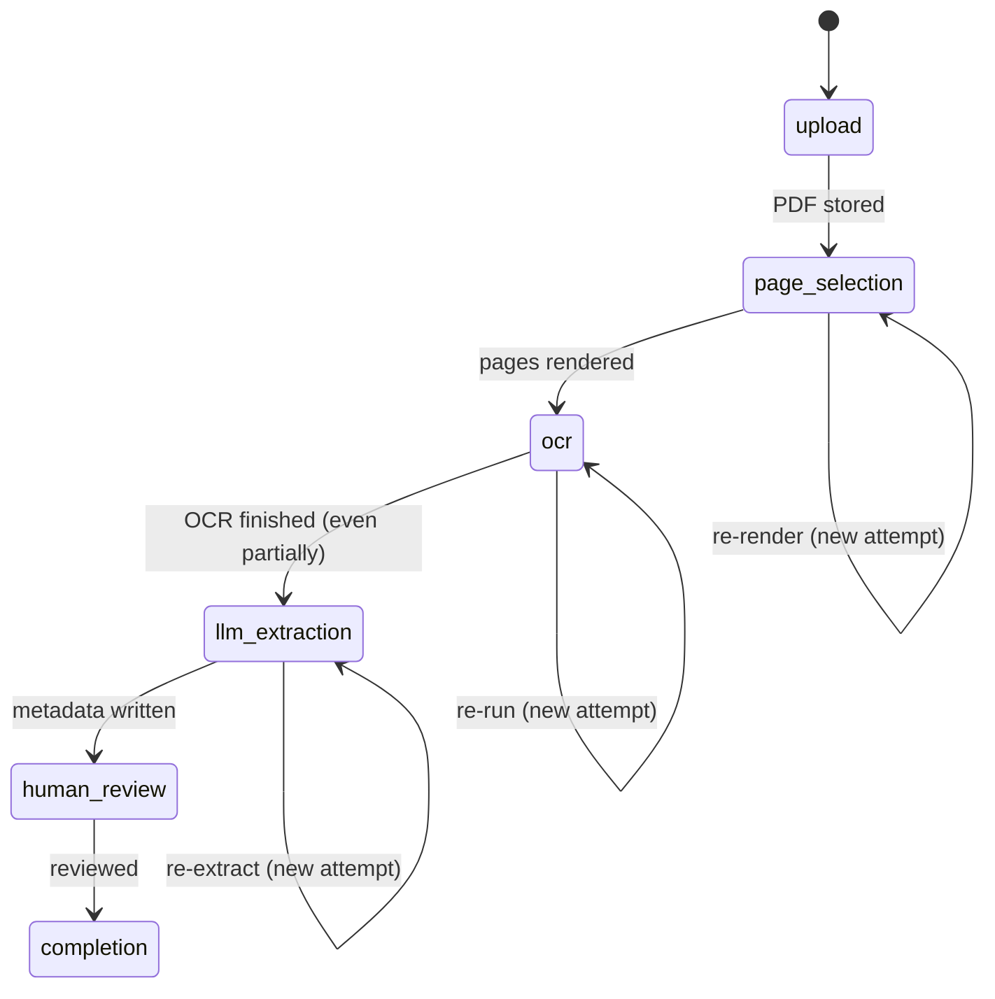

# Processing Pipeline Overview

This is the map. Each stage has its own document; this page explains the order, the gates between
stages, and the state machine that ties them together.

| Stage | Document |
| --- | --- |
| Upload and page rendering | [pdf-and-pages.md](pdf-and-pages.md) |
| Image preprocessing | [preprocessing.md](preprocessing.md) |
| OCR | [ocr.md](ocr.md) |
| Metadata extraction | [extraction.md](extraction.md) |
| Jobs, retries, cancellation | [jobs-and-queues.md](jobs-and-queues.md) |

---

## 1. The path a book takes

```text
upload → select pages → render pages → preprocess → OCR → (OCR review) → extract → (metadata review) → complete
```

The **backend** tracks six stages:

```text
upload → page_selection → ocr → llm_extraction → human_review → completion
```

The **UI** shows seven steps, because preprocessing is a per-page setting rather than a stage. The
mapping is owned by `frontend/src/lib/workflow-state.ts` and explained in
[frontend](../application/frontend.md#5-the-seven-step-workflow-model).

`ocr_review` is also not a backend stage — it is the interval where OCR is complete and extraction has
not started. It exists because correction there measurably improves extraction.

---

## 2. Stage gates

Each stage may only start when its predecessor reached a terminal state
(`completed`, `failed`, or `cancelled`). `StageManager._validate_sequential` enforces this.



### Two deliberate exceptions

1. **Legacy books.** Books created before stage tracking have no stage rows at all. The sequential
   check is skipped for them so they are not locked out of the pipeline forever.
2. **Partial OCR advances.** A run where *some* pages failed still completes the OCR stage. The failed
   pages stay flagged on `pages.ocr_error`, but the text that did succeed is reviewable. Only an
   all-pages-failed run fails the stage.

---

## 3. Re-running a stage

Re-running an upstream stage calls `StageManager.reset_from_stage`, which marks that stage **and
every stage after it** as `cancelled`, then initiates a fresh attempt of the re-run stage.

Consequences worth knowing:

| Action | Effect |
| --- | --- |
| Re-run OCR | `llm_extraction` and `human_review` become stale; existing metadata stays on disk but is no longer authoritative |
| Re-run extraction | `human_review` becomes stale; standard fields are replaced, `custom_fields` is preserved |
| Re-render pages | Page rows are rewritten in place; `processed_image_path` is cleared so preprocessing re-runs |

`attempt` is per stage and increments on each re-run. Nothing is deleted, so the full history is
reconstructable from `book_stage_status`.

---

## 4. Where progress is recorded

Three places, each with a different purpose:

| Record | Granularity | Survives restarts | Used by |
| --- | --- | --- | --- |
| `jobs.progress` + `last_progress_at` | per job, 0–100 | yes | UI progress bar, stale-job reaper |
| `book_stage_status` | per stage, per attempt | yes | Stepper, stage gates, staleness detection |
| SSE `job.progress` events | live stream | no | Instant UI updates between polls |

SSE is a *notification* channel, never the source of truth. A client that misses every event still
converges by polling `jobs` and `stages`.

---

## 5. Data handoff between stages

```text
PDF ──render──▶ pages/image_path
                    │
                    ├─preprocess─▶ pages/processed_image_path (+ preprocessing_config)
                    │
                    └─OCR────────▶ ocr_results.raw_text
                                        │
                                        ├─normalise──▶ cleaned_text
                                        └─human──────▶ corrected_text
                                                            │
                                                            ▼
                            extraction reads corrected → cleaned → raw (first non-empty)
                                                            │
                                                            ▼
                                        metadata.fields + metadata_field_evidence
```

The precedence `corrected_text → cleaned_text → raw_text` is applied in `llm_tasks._validate_book_context`.
That means a user's correction is *always* what the model sees, without any explicit "save before
extract" step.

Pages with empty text after that resolution are skipped. If **no** page has text, the job fails with
"No OCR text available for extraction".

---

## 6. Resource model

The pipeline is designed for a CPU-only host and serialises aggressively:

| Constraint | Value | Where |
| --- | --- | --- |
| One book at a time | global Redis lock `pipeline:single-book`, 300 s TTL | `tasks/pipeline_lock.py` |
| One worker process | `--concurrency=1`, queues `ocr,llm,default` | `docker-compose.production.yml` |
| OCR pages | sequential within a book | `tasks/ocr_tasks.py` |
| OCR threads | `OCR_THREAD_WORKERS` (default 4) | `core/config.py` |
| LLM batches | up to 2 in flight (`MAX_PARALLEL_BATCHES`) | `services/llm_service.py` |
| One model loaded | `OLLAMA_MAX_LOADED_MODELS=1`, `NUM_PARALLEL=1` | compose |

Measured on the reference host for a 30-page Telugu book: OCR ≈ 568 s (19%) and extraction ≈ 2,434 s
(81%). Extraction dominates wall-clock; per-page OCR ranges from 3 s to 86 s, with the slowest four
pages taking 54% of OCR time. See [`learnings/015`](../../learnings/015-service-inventory-and-gating.md).

---

## 7. Failure and recovery

| Failure | Detection | Recovery |
| --- | --- | --- |
| Exception in a task | Celery `task_failure` signal | Job → failed, stage → failed, notification + SSE |
| Worker killed mid-task | `acks_late` + `task_reject_on_worker_lost` | Celery redelivers the task |
| Worker never returns | Job reaper (300 s loop, 90 min threshold) | Job → failed, book released, stage failed |
| User cancels | API sets job `cancelled` then revokes | Task sees `is_cancelled` and stops; `task_revoked` reconciles |
| Re-run while old task alive | `is_superseded_async` | Old task refuses to write; new run owns the stage |
| Transient DB/network error | Exception type check | `self.retry` (up to 3, 30–60 s) |
| One page fails OCR | Per-page try/except | Recorded on `pages.ocr_error`, run continues |
| All pages fail OCR | `ocr_outcome()` | Job failed, stage failed, book released to `pages_selected` |

The book is never left wedged in `ocr_running` or `llm_running`: every failure path explicitly
releases it.

---

## 8. Invariants

1. A stage row is only ever written on the **same** session that owns the transaction — a second
   session asking `FOR UPDATE` on the book deadlocks.
2. `jobs.progress` never decreases.
3. A task checks `should_stop()` before each unit of work and before writing a terminal status.
4. Results are only persisted when the job is still `running` and not superseded.
5. `books.status` is derived from stage rows; never hand-set it outside `StageManager`.

