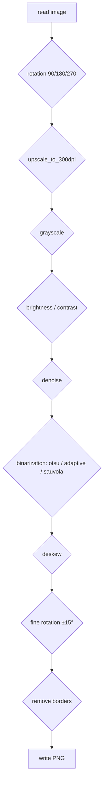

# Image Preprocessing

Preprocessing is the OpenCV chain applied between page rendering and OCR. It is configurable **per
page**, and every default is chosen to avoid destroying Indic letterforms.

- Implementation: `backend/app/services/preprocessing.py`
- Per-page storage: `pages.preprocessing_config` (JSONB)
- Execution: `preprocess_pages_for_book`, or lazily during OCR

---

## 1. Defaults

`DEFAULT_PREPROCESSING_CONFIG`:

| Key | Default | Meaning |
| --- | --- | --- |
| `grayscale` | `true` | Convert to single channel |
| `brightness` | `0` | −100…100 shift |
| `contrast` | `0` | −100…100 scaling |
| `binarization` | `null` | **Off by default** — `null`, `otsu`, `adaptive`, or `sauvola` |
| `binarization_method` | `"sauvola"` | Method used *if* binarization is enabled |
| `sauvola_window` | `25` | Local window (forced odd) |
| `sauvola_k` | `0.2` | Sauvola k |
| `adaptive_block_size` | `11` | Adaptive threshold block |
| `adaptive_c` | `2` | Adaptive threshold C |
| `deskew` | `true` | Correct small rotations |
| `denoise` | `false` | **Off by default** |
| `denoise_strength` | `7` | Non-local-means strength |
| `upscale_to_300dpi` | `true` | Upscale if the render DPI is below 300 |
| `remove_borders` | `true` | Crop uniform margins |
| `border_content_ratio` | `0.85` | Uniformity threshold for border detection |
| `rotation` | `0` | Coarse rotation, multiples of 90° |
| `rotation_angle` | `0.0` | Fine rotation, clamped to ±15° |

**Why binarization and denoising are off.** Sauvola binarization and non-local-means denoising erode
the *shiro-rekha*, the horizontal line that joins Devanagari and Telugu letters into syllables.
Losing it merges or splits characters and Tesseract's accuracy collapses. Both are available per page
for genuinely poor scans, but they are not defaults.

---

## 2. Pipeline order

`run_pipeline(image_path, config, output_path, source_dpi=None)` applies steps in a fixed order.
Order is not arbitrary — each step's input assumptions depend on the previous one.



| Step | Why here |
| --- | --- |
| Coarse rotation first | Every later step should see an upright page |
| Upscale before binarizing | Interpolating a binary image produces artefacts |
| Grayscale before threshold | Thresholding requires a single channel |
| Denoise before binarize | Denoising after thresholding smears the binary edges |
| Deskew after binarize | The Otsu inverse mask is the cheapest reliable angle source |
| Fine rotation after deskew | Manual nudges apply last, to the already-corrected page |
| Borders last | Cropping earlier would change the coordinates deskew computed against |

### Upscale is usually a no-op

```python
if source_dpi is None:
    source_dpi = settings.ocr_render_dpi
```

Pages are rendered at `OCR_RENDER_DPI` (default 300), so `upscale_to_300dpi` does nothing at the
default. It only becomes active when pages are rendered below 300 DPI — at 200 DPI it is a 1.5× cubic
upscale.

That upscale was measured to **cost** accuracy for both the default path and the Telugu line model;
see [`learnings/027`](../../learnings/027-default-preprocessing-upscale-benchmark.md) and
[`learnings/028`](../../learnings/028-line-model-preprocessing-benchmark.md). In practice: render at
300 DPI and let the upscale stay inert.

---

## 3. Sauvola binarization

```text
T(x, y) = m(x, y) · (1 + k · (s(x, y) / R − 1))
```

where `m` and `s` are the local mean and standard deviation over `sauvola_window`, and `R = 128`.
A pixel is ink when its intensity exceeds the local threshold.

Unlike Otsu's single global threshold, Sauvola adapts per region, which preserves text under stained
or shadowed paper. That is why it is the configured default *method* even though binarization itself
is disabled by default.

All thresholds and means are computed with `cv2.boxFilter` (integral-image based), so cost is linear
in pixels rather than window area.

---

## 4. Deskew

1. Otsu-threshold the inverse so ink is white.
2. Collect ink pixel coordinates.
3. `cv2.minAreaRect` → angle.
4. Normalise the angle to ±45°, then to a rotation amount.
5. Skip if `|angle| < 0.5°`.
6. Rotate with `INTER_CUBIC` and `BORDER_REPLICATE` (no black wedges).

Fewer than 10 ink pixels is treated as "nothing to measure" and the image passes through unchanged.

---

## 5. Border removal

Walks inward from each edge in strips (`h//40`, `w//40`, minimum 8 px). A strip is "uniform" when its
mean is near the page median — supporting both light and dark pages via `border_content_ratio`.

Safety rails:

- Images under 20×20 are untouched.
- If the resulting crop would remove more than 70% of either dimension, the original is returned. This
  prevents a mostly-blank page from collapsing to a sliver.

---

## 6. Where preprocessing runs

| Path | Trigger | Behaviour |
| --- | --- | --- |
| `preprocess_pages_for_book` | User starts OCR | Preprocesses every page that has a config and no `processed_image_path`, then chains to `run_ocr_for_book` |
| `_process_page_async` | During OCR | Lazily preprocesses a single page if it still lacks `processed_image_path` |
| `apply_preprocessing_bulk` | Admin/bulk action | Applies one config to every page and records it on each row |

The preprocessing task **does not fail silently into OCR**: if preprocessing raises, the job is marked
failed and `run_ocr_for_book` is not dispatched. OCR never runs on an image whose preprocessing
failed.

If the preprocessing job is cancelled or superseded, it returns without chaining.

---

## 7. Per-page configuration flow

`pages.preprocessing_config` is the single source of truth for a page.

- Set to `DEFAULT_PREPROCESSING_CONFIG` when the page is first rendered.
- Replaced wholesale by `apply_preprocessing_bulk`.
- Editable per page from the preprocessing screen, which shows a live preview via
  `POST /api/pages/{page_id}/preview`.

Because the config is stored per page, two pages of the same book can be processed completely
differently — which is what uneven scans require.

---

## 8. Reproducibility

Preprocessing is deterministic: OpenCV operations on a fixed input with fixed parameters produce
identical output. There is no randomness, no time-dependence, and no model involved.

The one environmental dependency is the OpenCV build. A version change can alter interpolation or
thresholding results in the last bits, so archived page images — not the config — are the reliable
artefact for reproducing an old OCR result.

---

## 9. Limitations

1. **No dewarping.** Curved page text (tight binding) is not straightened.
2. **No page-type-aware defaults.** The same defaults apply to a cover and a dense text page; per-page
   tuning is manual.
3. **No colour correction beyond brightness/contrast.**
4. **No automatic quality gate.** A hopeless page is preprocessed and OCR'd anyway, and fails later.

